<!-- ============================================ -->
<!-- LAXMAN TARIHALKAR | GITHUB PROFILE README   -->
<!-- ============================================ -->

<!-- PREMIUM DARK / LIGHT BANNER -->

  <picture>
    <source media="(prefers-color-scheme: dark)" srcset="dark.svg">
    <source media="(prefers-color-scheme: light)" srcset="light.svg">
    
  </picture>

<!-- INTRODUCTION -->
<h1 align="center">Hi 👋, I'm Laxman Tarihalkar</h1>

<h3 align="center">
  Full-Stack Developer | MCA Graduate (2026) | India 🇮🇳
</h3>

  Building modern web applications, exploring AI technologies,
  and solving problems through code.

  
  

---

<!-- ABOUT ME -->
## 👨‍💻 About Me

- 🎓 MCA Graduate (2026) from Jain College of Engineering, Belagavi.
- 💻 Focused on Full-Stack Web Development.
- ⚛️ Building applications using React.js, JavaScript, Node.js and Express.js.
- 🗄️ Working with MongoDB, MySQL and Supabase.
- 🤖 Exploring Generative AI and AI-powered applications.
- 🧩 Practicing Data Structures and Algorithms.
- 🚀 Building practical projects to strengthen my development skills.
- 🎯 Open to Software Developer and Full-Stack Developer opportunities.
- 📫 Email: **laxmantarihalkar631@gmail.com**

---

<!-- TECH STACK -->
## 🛠️ Technical Skills

### 💻 Frontend Development

  

### ⚙️ Backend Development

  

### 🗄️ Database & Tools

  

### 🧠 Programming Languages

  

---

<!-- GITHUB ANALYTICS -->
## 📊 GitHub Analytics

  
  

  

---

<!-- CONTRIBUTION ACTIVITY -->

## 📈 Contribution Activity

  

<!-- GITHUB TROPHIES -->
## 🏆 GitHub Achievements

  

---

<!-- FEATURED PROJECTS - TWO COLUMN GRID -->
<h2 align="center">🚀 Featured Projects</h2>

<table>
<tr>
<td width="50%" valign="top">

<h3 align="center">🚗 RentRide</h3>

  A multi-vehicle rental platform for discovering, booking,
  and managing vehicle rentals with availability tracking,
  secure payments and interactive maps.

  <b>Tech Stack</b>

  React.js • Node.js • Express.js • Supabase

  

</td>

<td width="50%" valign="top">

<h3 align="center">🤖 Text-to-Image Generation</h3>

  An AI-powered platform that transforms text prompts
  into creative images using AI models and modern
  web technologies.

  <b>Tech Stack</b>

  JavaScript • React.js • Node.js • AI APIs

  

</td>
</tr>

<tr>
<td width="50%" valign="top">

<h3 align="center">🌐 Personal Portfolio</h3>

  A personal portfolio website showcasing my technical
  skills, projects, and development journey.

  <b>Tech Stack</b>

  React.js • Tailwind CSS • JavaScript

  

</td>

<td width="50%" valign="top">

<h3 align="center">📚 DSA Notes & Solutions</h3>

  A collection of Data Structures and Algorithms notes,
  concepts, coding examples, and problem solutions.

  <b>Focus</b>

  Java • DSA • Problem Solving

  

</td>
</tr>
</table>

  

---

<!-- CONTRIBUTION SNAKE -->
## 🐍 Contribution Snake

  

---

<!-- CONNECT -->
## 🌐 Connect With Me

  
  
  <!-- Add your actual LinkedIn URL here -->

---

<!-- FOOTER -->

  <i>"Consistency, curiosity, and code — one project at a time."</i>

  ⭐ If you find my projects useful, consider giving them a star!

